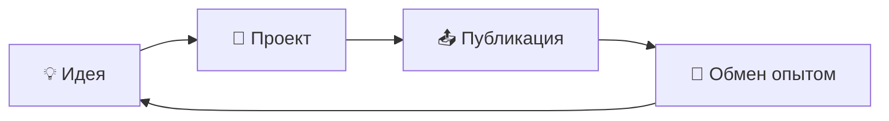

# Collection of solutions

# 🚀 Творческий хаб

**Пространство для независимого творчества, экспериментов и роста**

---

## ✨ О репозитории

> Этот репозиторий создан для нашего **независимого творчества** — места, где идеи превращаются в код, а эксперименты — в проекты.

Здесь вы можете **свободно загружать**:

- 🧩 Любые таски и задания
- 🐾 Pet-проекты и эксперименты
- 💡 Идеи, наброски и прототипы
- 🛠️ Всё, что является вашей доброй волей к творчеству и кодингу

---

## 📚 Коллекция знаний

Помимо свободного творчества, здесь будет собираться **коллекция базовых и интересных задач и описаний**, которые помогут вам:

| 🎯 Цель | 📌 Описание |
|--------|-------------|
| 📘 Обучение | Освоить базу через практику |
| 🧠 Мышление | Прокачать алгоритмическое мышление |
| 🚀 Карьера | Подготовиться к профессиональной деятельности |
| 🤝 Сообщество | Делиться опытом и учиться друг у друга |

---

## 🗂️ Как это работает

1. **Придумайте** — любая идея имеет ценность
2. **Создайте** — пишите код в своё удовольствие
3. **Поделитесь** — загрузите в репозиторий
4. **Обсудите** — получите фидбек и вдохновение

---

## 🧭 Принципы

- 🌈 **Свобода** — творите так, как хочется именно вам
- 📖 **Открытость** — делитесь и учитесь друг у друга
- 🎓 **Развитие** — каждая задача делает нас сильнее
- 💛 **Уважение** — доброжелательность превыше всего

---

### 🎉 Добро пожаловать в сообщество творцов и кодеров!

*Пусть каждая строка кода приносит радость.*

**Happy coding! 🚀**

